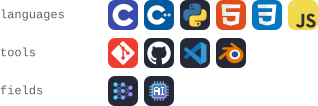

<!--
  GENERATED FILE: do not edit by hand.
  Edit profile.toml, then run `python build.py` (or just push: the build workflow regenerates it).
-->

# \[SHOGUN\] ASHRAFUL HAQUE SHRABON

<samp>Competitive programmer | C · C++ · Python | Machine Learning &amp; AI | Blender 3D modeler</samp>

<a href="mailto:cse.shrabon@gmail.com"><picture><source media="(prefers-color-scheme: dark)" srcset="assets/generated/btn-email-dark.svg"><source media="(prefers-color-scheme: light)" srcset="assets/generated/btn-email-light.svg"></picture></a>
<a href="https://www.linkedin.com/in/ashrafulhaqueshrabon"><picture><source media="(prefers-color-scheme: dark)" srcset="assets/generated/btn-linkedin-dark.svg"><source media="(prefers-color-scheme: light)" srcset="assets/generated/btn-linkedin-light.svg"></picture></a>
<a href="https://ashrafulhaqueshrabon.github.io/portfolio"><picture><source media="(prefers-color-scheme: dark)" srcset="assets/generated/btn-website-dark.svg"><source media="(prefers-color-scheme: light)" srcset="assets/generated/btn-website-light.svg"></picture></a>

### <samp>&gt; competitive programming</samp>

<a href="https://codeforces.com/profile/InternetShogun"><picture><source media="(prefers-color-scheme: dark)" srcset="assets/generated/btn-codeforces-dark.svg"><source media="(prefers-color-scheme: light)" srcset="assets/generated/btn-codeforces-light.svg"></picture></a>
<a href="https://atcoder.jp/users/InternetShogun"><picture><source media="(prefers-color-scheme: dark)" srcset="assets/generated/btn-atcoder-dark.svg"><source media="(prefers-color-scheme: light)" srcset="assets/generated/btn-atcoder-light.svg"></picture></a>
<a href="https://leetcode.com/u/internetshogun/"><picture><source media="(prefers-color-scheme: dark)" srcset="assets/generated/btn-leetcode-dark.svg"><source media="(prefers-color-scheme: light)" srcset="assets/generated/btn-leetcode-light.svg"></picture></a>
<a href="https://www.codechef.com/users/internetshogun"><picture><source media="(prefers-color-scheme: dark)" srcset="assets/generated/btn-codechef-dark.svg"><source media="(prefers-color-scheme: light)" srcset="assets/generated/btn-codechef-light.svg"></picture></a>
 
<a href="https://www.hackerrank.com/profile/ash_shrabon"><picture><source media="(prefers-color-scheme: dark)" srcset="assets/generated/btn-hackerrank-dark.svg"><source media="(prefers-color-scheme: light)" srcset="assets/generated/btn-hackerrank-light.svg"></picture></a>
<a href="https://judge.beecrowd.com/en/profile/268689"><picture><source media="(prefers-color-scheme: dark)" srcset="assets/generated/btn-beecrowd-dark.svg"><source media="(prefers-color-scheme: light)" srcset="assets/generated/btn-beecrowd-light.svg"></picture></a>
<a href="https://cses.fi/user/450345"><picture><source media="(prefers-color-scheme: dark)" srcset="assets/generated/btn-cses-dark.svg"><source media="(prefers-color-scheme: light)" srcset="assets/generated/btn-cses-light.svg"></picture></a>
<a href="https://vjudge.net/user/InternetShogun"><picture><source media="(prefers-color-scheme: dark)" srcset="assets/generated/btn-vjudge-dark.svg"><source media="(prefers-color-scheme: light)" srcset="assets/generated/btn-vjudge-light.svg"></picture></a>

### <samp>&gt; skills</samp>

<picture><source media="(prefers-color-scheme: dark)" srcset="assets/generated/skills-dark.svg"><source media="(prefers-color-scheme: light)" srcset="assets/generated/skills-light.svg"></picture>

### <samp>&gt; top languages</samp>

<picture><source media="(prefers-color-scheme: dark)" srcset="https://raw.githubusercontent.com/AshrafulHaqueShrabon/AshrafulHaqueShrabon/output/languages-dark.svg"><source media="(prefers-color-scheme: light)" srcset="https://raw.githubusercontent.com/AshrafulHaqueShrabon/AshrafulHaqueShrabon/output/languages-light.svg"></picture>

<picture><source media="(prefers-color-scheme: dark)" srcset="https://raw.githubusercontent.com/AshrafulHaqueShrabon/AshrafulHaqueShrabon/output/arcade-dark.svg"><source media="(prefers-color-scheme: light)" srcset="https://raw.githubusercontent.com/AshrafulHaqueShrabon/AshrafulHaqueShrabon/output/arcade-light.svg"></picture>

